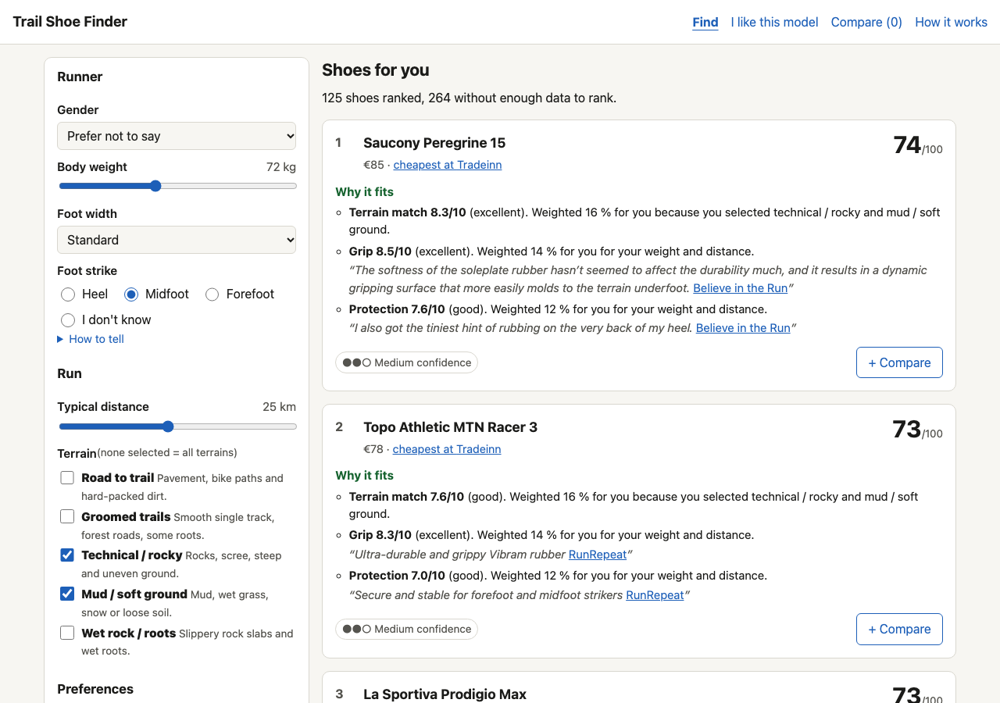
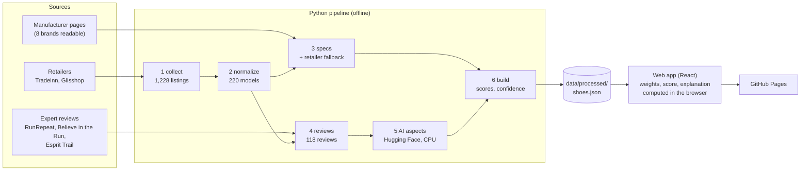

# Trail Shoe Finder

**Find trail running shoes that fit your profile, with every score explained.**

You describe yourself (weight, distance, terrain, foot strike, preferences) and set hard
filters (price, drop, brands...). The app ranks the trail shoes currently sold by French
retailers, tells you *why* each one fits and what to watch out for, and shows how much
data stands behind each score.

**Live site:** https://pierrebando.github.io/trailshoesim/ *(available once deployed, see
[Deployment](#deployment))*



## How it works (one paragraph)

A Python **pipeline** runs offline on a laptop. It collects the shoes on sale and their
prices from two retailers, reads technical specs from manufacturer pages, and finds expert
reviews. A small **AI step** reads those reviews. The pipeline then scores every shoe on
8 criteria (cushioning, protection, grip, stability, responsiveness, lightness,
durability, roomy fit) and 5 terrains, and writes everything to one JSON file. The
**web app** (React, static, on GitHub Pages) loads that file and computes, in the browser,
the weights of your profile, the score out of 100 and the explanation. Nothing is sent to
a server.



## Data sources and what we take from each

| Source | What we take | What we never take |
|---|---|---|
| **Tradeinn**, **Glisshop** (retailers) | which shoes are on sale, price, buyer rating and review count, product link; specs shown on the product page | descriptions, images, buyer reviews |
| **Manufacturer pages** (Merrell, Mizuno, Saucony, Scarpa, NNormal, Dynafit, Lowa, Puma) | weight, stack, drop, lug depth, foam, rubber... each value with the exact sentence it comes from | marketing text |
| **RunRepeat**, **Believe in the Run**, **Esprit Trail** (expert reviews) | a link, our selection of at most 30 words, RunRepeat's lab measurements | the article text (kept only in a local, uncommitted cache for the AI step) |

**Legal and ethical approach** (details in [docs/sources.md](docs/sources.md)):

- `robots.txt` and the terms of use are read before collecting anything.
- A site that blocks bots, bans AI crawlers or forbids extraction is **not** collected. Le Pape, i-Run and Doctors of Running were skipped this way, and so were 16 manufacturer sites (bot protection, AI-crawler bans, restrictive or unreadable terms, or unreachable).
- At most 1 request per second, an identified User-Agent with a contact address, and every page cached so it is downloaded only once.
- Raw HTML and full articles are never committed: only facts, excerpts of 30 words at most, and links.

## Scoring in 10 lines

Full specification: [docs/scoring-spec.md](docs/scoring-spec.md); every constant is in
[pipeline/config/scoring.yaml](pipeline/config/scoring.yaml).

1. Each spec field is taken from the manufacturer, else a lab measurement, else the retailer; its source is kept.
2. Each criterion blends a **spec score** (e.g. more stack height means more cushioning, deeper lugs mean more grip) with an **expert score** from the reviews.
3. The expert part grows with the number of reviews; one review only moves a score a little.
4. Terrain scores (mud, rock, groomed trails...) use specs only, mainly lug depth.
5. Missing data is never guessed: a criterion without data has no score, and confidence drops.
6. Your profile sets the weights: heavier runners and longer runs weigh cushioning, stability and durability more, and this changes smoothly.
7. Preference sliders, the terrains you pick, your foot strike (preferred drop) and foot width add to the weights.
8. Score out of 100 = weighted average of the shoe's values, plus 10 % for the buyer rating, adjusted for small samples. An unknown value counts as a neutral 5/10.
9. A shoe is not ranked if less than 60 % of what matters to you is known about it.
10. "Why it fits" = criteria where the shoe is good **and** better than the other shoes that pass your filters.

## The AI component in 10 lines

Details: [docs/methodology-nlp.md](docs/methodology-nlp.md) and
[docs/evaluation.md](docs/evaluation.md).

1. Input: the conclusion and pros/cons of the 118 expert reviews, in English and French.
2. Each review is split into sentences.
3. A multilingual **sentence-embedding model** (`paraphrase-multilingual-mpnet-base-v2`) finds which criterion a sentence talks about, by similarity to short descriptions of each criterion.
4. A zero-shot **NLI model** (`mDeBERTa-v3-base-xnli-multilingual`) decides the direction. It checks whether the sentence implies "The shoe is light." or "The shoe is heavy.".
5. Both models are open Hugging Face models, run offline on a laptop CPU. There is no API and no data leaves the machine.
6. Sentence scores are averaged per review and per model; the clearest sentence is kept as evidence (30 words max).
7. Evaluation: 30 models × 8 criteria were labelled low / medium / high / not mentioned. The labels were made by an AI assistant at the owner's request; 5 rows were checked by the owner.
8. The pipeline finds **89 %** of the criteria the reviews mention.
9. On the held-out half: rank correlation (Spearman) 0.37 → **0.57**, and errors in the wrong direction (low read as high or vice versa) 21 → **6** after switching to NLI.
10. Accuracy on the three levels (0.62) is only at the level of "always answer high" (0.60): the scores order shoes better than they label them.

## Limitations and honest caveats

- **Heuristics, not science.** The rules are reasonable rules of thumb from the running world, transparent and tunable, but not validated biomechanics.
- **Prices are snapshots**, read on the build date (shown in the footer). Always check the retailer page.
- **Partial coverage**:
  - only 45 of 220 models have a manufacturer page we could read;
  - 81 have an expert review;
  - for a typical profile about 140 of the 217 shoes have too little data to be ranked;
  - widths are known for 4 shoes and waterproofing for 16, so these filters hide most shoes.
- **Two retailers only**: Le Pape and i-Run could not be collected, so the catalogue is what Tradeinn and Glisshop sell.
- **Foot strike and foot width are self-declared** and only nudge the weights (the drop preference weighs about 5 %).
- **The AI step is imperfect**: about 6 correct levels in 10; responsiveness and durability are its weakest criteria. Its labels were not made by an independent human.
- **Retailer listings mix variants** (colours, Gore-Tex versions) of a model, so a price range can mix them.

## How to reproduce

Requirements: Python 3.11+, Node 20+. All commands run from the repository root.

```bash
# Python environment
python3.11 -m venv .venv && source .venv/bin/activate
pip install -e ".[dev,nlp]"            # nlp = Hugging Face models (~1 GB, phase 5 only)
export TSF_CONTACT="you@example.org"   # contact shown in the User-Agent

# Pipeline, in order (pages already in data/raw/ are not downloaded again)
python -m pipeline.collect --site all          # 1. retailer listings
python -m pipeline.normalize                   # 2. one record per model (uses needs_review.csv)
python -m pipeline.specs                       # 3. manufacturer specs + retailer fallback
python -m pipeline.reviews --source all        # 4. expert reviews (uses reviews_needs_review.csv)
python -m pipeline.nlp                         # 5. AI aspect scores (~8 min on CPU)
python -m pipeline.build                       # 6. data/processed/shoes.json + build report

# Checks
pytest && ruff check .

# Web app
cd web && npm install && npm run dev           # http://localhost:5173
npm test && npm run build                      # engine tests, static site in web/dist/
```

A fresh clone has no `data/raw/` cache, so step 1 downloads everything again (politely:
about an hour). The committed `data/interim/` and `data/processed/` let you skip straight to
the web app.

## Data refresh

To update prices and the catalogue (e.g. once a month):

1. `python -m pipeline.collect --site all --refresh`: re-downloads the retailer pages, about 1,300 requests at 1 per second, so roughly 25 minutes.
2. `python -m pipeline.normalize`: check `data/interim/needs_review.csv` for new uncertain matches and fill the `decision` column.
3. `python -m pipeline.specs`: only new models' pages are downloaded; the retailer fallback is rebuilt from the fresh pages.
4. `python -m pipeline.reviews --source all`, then check `data/interim/reviews_needs_review.csv`.
5. `python -m pipeline.nlp`, then `python -m pipeline.build`, and read `data/processed/build_report.md`.
6. `pytest`, then commit `data/interim/` and `data/processed/` and push to `main`. GitHub Actions rebuilds and redeploys the site.

Re-check `robots.txt` and the terms of each site first ([docs/sources.md](docs/sources.md)): they change.

## Deployment

`.github/workflows/deploy.yml` runs on every push to `main`. It installs Node, runs the
web tests, builds `web/` from the committed `data/processed/` and publishes `web/dist/` with
`actions/deploy-pages`. The pipeline is not run in CI.

## Repository map

| Path | Content |
|---|---|
| [CLAUDE.md](CLAUDE.md) | Project rules, decisions, all commands, phase status |
| [pipeline/](pipeline/) | Python pipeline: `collect/`, `normalize/`, `specs/`, `reviews/`, `nlp/`, `build/`, `utils/`; `models.py` = data model (pydantic) |
| [pipeline/config/](pipeline/config/) | `scoring.yaml` (all scoring constants), `aspects.yaml` (AI step), brand and title vocabularies |
| [data/interim/](data/interim/) | Intermediate data of each phase (committed; facts, short excerpts, links only) |
| [data/processed/](data/processed/) | `shoes.json`, `meta.json`, `scoring_config.json` read by the web app; `build_report.md` |
| [schema/](schema/) | JSON Schemas generated from `pipeline/models.py` |
| [web/](web/) | React + Vite + TypeScript app; `src/engine/` = scoring in pure TypeScript |
| [tests/](tests/) | pytest suite (209 tests; HTML fixtures are hand-written, fictional) |
| [docs/](docs/) | Scoring spec, AI method and evaluation, sources and access checks, data coverage, phase reports |
| [.github/workflows/](.github/workflows/) | GitHub Pages deployment |
