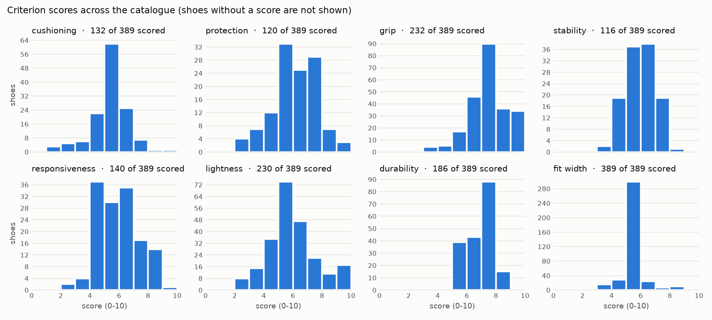

# Build report (generated by `python -m pipeline.build`)

Build date 2026-10-29, pipeline 0.1.0, scoring.yaml 0.4.1, aspects.yaml 0.3.0.

## Counts

* Shoes in `shoes.json`: **389** (51 brands, 1955 retailer offers, 197 expert reviews).
* Models dropped: 12 — `plus8000-plus8000-tigor-3`: no gender shown by any retailer listing; `asics-gel-nimbus-tr-28`: no gender shown by any retailer listing; `cmp-altak-2`: no gender shown by any retailer listing; `joma-sierra-barefoot`: no gender shown by any retailer listing; `joma-tundra-barefoot`: no gender shown by any retailer listing; `kilpi-racery-low`: no gender shown by any retailer listing; `kilpi-speede-low`: no gender shown by any retailer listing; `mount-to-coast-m1`: no gender shown by any retailer listing; `on-cloudvista-3`: no gender shown by any retailer listing; `oriocx-etna-23-pro`: no gender shown by any retailer listing; `salomon-pulsar`: no gender shown by any retailer listing; `scarpa-spin-infinity`: no gender shown by any retailer listing
* Prices read between 2026-10-28 and 2026-10-29.

## Spec completeness per field

Tier used for each known value (priority manufacturer > lab > retailer).

| Field | Known | Manufacturer | Manual (student) | Lab (RunRepeat) | Retailer |
|---|---|---|---|---|---|
| weight_g | 180 (46%) | 44 | 0 | 64 | 72 |
| weight_women_g | 119 (31%) | 3 | 0 | 0 | 116 |
| stack_heel_mm | 85 (22%) | 19 | 0 | 66 | 0 |
| stack_forefoot_mm | 85 (22%) | 19 | 0 | 66 | 0 |
| drop_mm | 227 (58%) | 44 | 0 | 18 | 165 |
| lug_depth_mm | 144 (37%) | 27 | 0 | 62 | 55 |
| lug_spacing | 0 (0%) | 0 | 0 | 0 | 0 |
| platform_width_heel_mm | 70 (18%) | 0 | 0 | 70 | 0 |
| platform_width_forefoot_mm | 70 (18%) | 0 | 0 | 70 | 0 |
| midsole_softness_ac | 42 (11%) | 0 | 0 | 42 | 0 |
| energy_return_forefoot_pct | 56 (14%) | 0 | 0 | 56 | 0 |
| midsole_foam | 209 (54%) | 35 | 0 | 0 | 174 |
| plate | 83 (21%) | 10 | 0 | 0 | 73 |
| outsole_rubber | 314 (81%) | 42 | 0 | 0 | 272 |
| waterproof | 53 (14%) | 0 | 0 | 0 | 53 |
| upper_notes | 40 (10%) | 40 | 0 | 0 | 0 |
| width_options | 7 (2%) | 7 | 0 | 0 | 0 |
| fit_width_tag | 389 (100%) | 0 | 0 | 0 | 389 |

## Criterion scores

A score needs a spec sub-score (enough spec inputs known) or at least one expert review that mentions the criterion; otherwise it is null.

| Criterion | Scored | Specs only | Reviews only | Both | Median |
|---|---|---|---|---|---|
| cushioning | 132 (34%) | 11 | 47 | 74 | 5.5 |
| protection | 120 (31%) | 17 | 35 | 68 | 6.0 |
| grip | 232 (60%) | 139 | 15 | 78 | 7.0 |
| stability | 116 (30%) | 22 | 31 | 63 | 6.0 |
| responsiveness | 140 (36%) | 43 | 46 | 51 | 6.0 |
| lightness | 230 (59%) | 113 | 19 | 98 | 5.8 |
| durability | 186 (48%) | 89 | 51 | 46 | 7.3 |
| fit_width | 389 (100%) | 275 | 0 | 114 | 5.0 |

## Terrain scores

| Terrain | Scored |
|---|---|
| road_to_trail | 144 (37%) |
| groomed_mixed | 144 (37%) |
| technical_rocky | 111 (29%) |
| muddy_soft | 144 (37%) |
| wet_roots | 62 (16%) |

## Confidence

| Level | Shoes |
|---|---|
| high | 4 |
| medium | 61 |
| low | 324 |

Most frequent reasons a shoe is not one level higher:

* Spec completeness too low: 358 shoes
* 0 expert reviews: 225 shoes
* 1 expert review: 22 shoes
* 0 buyer reviews: 10 shoes
* 1 buyer reviews: 8 shoes
* 4 buyer reviews: 5 shoes

### The 10 shoes with the lowest confidence

| Shoe | Level | Spec completeness | Expert reviews | Buyer reviews | Criteria scored |
|---|---|---|---|---|---|
| asics-blazeblast | low | 0% | 0 | 0 | 1/8 |
| boreal-bamba | low | 0% | 0 | 0 | 1/8 |
| cmp-rahunii | low | 0% | 0 | 0 | 1/8 |
| craft-pure-tr | low | 0% | 0 | 0 | 1/8 |
| craft-vild-1 | low | 0% | 0 | 0 | 1/8 |
| helly-hansen-buzzard-tr | low | 0% | 0 | 0 | 1/8 |
| helly-hansen-featherswift-tr-2 | low | 0% | 0 | 0 | 1/8 |
| hoka-torrent-5 | low | 0% | 0 | 0 | 1/8 |
| hummel-earth-trail-one | low | 0% | 0 | 0 | 1/8 |
| inov-8-mudtalon-speed-2 | low | 0% | 0 | 0 | 1/8 |

## Automatic flag: specs and reviews disagree

Criteria whose spec and expert sub-scores differ by 4 points or more.

| Shoe | Criterion | Spec sub-score | Expert sub-score |
|---|---|---|---|
| topo-athletic-pursuit-2 | grip | 9.4 | 0.8 |
| merrell-vapor-glove-6 | durability | 7.5 | 0.3 |
| merrell-agility-peak-6 | fit_width | 8.5 | 2.5 |
| topo-athletic-terraventure-4 | grip | 9.4 | 3.6 |
| xero-shoes-mesa | cushioning | 1.0 | 6.7 |
| la-sportiva-ultra-raptor-2 | fit_width | 8.5 | 2.9 |
| salomon-xa-pro-3d-9 | responsiveness | 3.6 | 8.9 |
| merrell-mtl-long-sky-2-matryx | stability | 8.3 | 3.0 |
| xero-shoes-mesa | protection | 2.0 | 7.3 |
| merrell-trail-glove-8 | protection | 2.1 | 7.3 |
| inov-8-trailfly-max | protection | 8.3 | 3.2 |
| xero-shoes-prio | protection | 2.0 | 7.1 |
| saucony-xodus-ultra-4 | protection | 8.5 | 3.5 |
| nnormal-tomir-2 | stability | 5.6 | 0.6 |
| merrell-nova-4 | grip | 7.5 | 2.5 |
| merrell-trail-glove-7 | cushioning | 1.3 | 6.3 |
| altra-superior-7 | stability | 7.9 | 3.0 |
| merrell-mtl-long-sky-2-matryx | cushioning | 2.7 | 7.6 |
| xero-shoes-hfs-2 | cushioning | 1.0 | 5.8 |
| scott-supertrac-rc-3 | fit_width | 5.0 | 0.2 |
| xero-shoes-hfs-2 | protection | 2.0 | 6.8 |
| merrell-vapor-glove-6 | lightness | 10.0 | 5.2 |
| altra-olympus-275 | responsiveness | 4.9 | 0.1 |
| merrell-vapor-glove-6 | cushioning | 1.0 | 5.7 |
| altra-timp-6 | grip | 7.5 | 2.9 |
| xero-shoes-prio | cushioning | 1.0 | 5.4 |
| asics-gel-trabuco-13 | fit_width | 5.0 | 0.6 |
| adidas-agravic-4 | stability | 6.4 | 2.1 |
| saucony-peregrine-13 | stability | 6.8 | 2.5 |
| xero-shoes-mesa | responsiveness | 4.0 | 8.2 |
| keen-seek | protection | 7.6 | 3.3 |
| hoka-speedgoat-6 | grip | 8.2 | 4.1 |
| scarpa-spin-planet | grip | 5.8 | 9.9 |
| merrell-agility-peak-6 | grip | 9.0 | 4.9 |
| salomon-sense-ride-5 | lightness | 5.5 | 9.6 |
| merrell-trail-glove-8 | cushioning | 2.2 | 6.2 |

## Price outliers

All offers: 1955, from 32.99 to 242.49 EUR; usual range 16-198 EUR (quartiles 84 and 130).

| Price (EUR) | Shoe | Retailer | Offer |
|---|---|---|---|
| 198.99 | la-sportiva-cyklon-cross | tradeinn | https://www.tradeinn.com/runnerinn/fr/la-sportiva-chaussures-de-trail-running-cyklon-cross-gore-tex-/142273225/p |
| 199.99 | la-sportiva-cyklon-cross | tradeinn | https://www.tradeinn.com/runnerinn/fr/la-sportiva-chaussures-de-trail-running-cyklon-cross-gore-tex-/142273232/p |
| 200.00 | asics-gel-trabuco-mt | tradeinn | https://www.tradeinn.com/runnerinn/fr/asics-chaussures-de-trail-running-gel-trabuco-mt-gore-tex-/143119075/p |
| 200.00 | asics-gel-trabuco-mt | tradeinn | https://www.tradeinn.com/runnerinn/fr/asics-chaussures-de-trail-running-gel-trabuco-mt-gore-tex-/143119147/p |
| 200.00 | nnormal-kjerag-brut | tradeinn | https://www.tradeinn.com/runnerinn/fr/nnormal-chaussures-de-trail-running-kjerag-brut/141540768/p |
| 200.00 | nnormal-kjerag-brut | tradeinn | https://www.tradeinn.com/runnerinn/fr/nnormal-chaussures-de-trail-running-kjerag-brut/142098048/p |
| 200.00 | nnormal-kjerag-brut | tradeinn | https://www.tradeinn.com/runnerinn/fr/nnormal-chaussures-de-trail-running-kjerag-brut/143272975/p |
| 201.99 | x-bionic-x-bionic-terraskin-x03 | tradeinn | https://www.tradeinn.com/runnerinn/fr/x-bionic-chaussures-de-trail-running-terraskin-x01/142876375/p |
| 201.99 | x-bionic-x-bionic-terraskin-x03 | tradeinn | https://www.tradeinn.com/runnerinn/fr/x-bionic-chaussures-de-trail-running-terraskin-x01/142876376/p |
| 201.99 | x-bionic-x-bionic-terraskin-x03 | tradeinn | https://www.tradeinn.com/runnerinn/fr/x-bionic-chaussures-de-trail-running-terraskin-x01/142876377/p |
| 201.99 | x-bionic-x-bionic-terraskin-x03 | tradeinn | https://www.tradeinn.com/runnerinn/fr/x-bionic-chaussures-de-trail-running-terraskin-x01/142876378/p |
| 203.99 | la-sportiva-jackal-2 | tradeinn | https://www.tradeinn.com/runnerinn/fr/la-sportiva-chaussures-de-trail-running-jackal-ii/139634132/p |
| 209.90 | la-sportiva-cyklon-cross | glisshop | https://www.glisshop.com/chaussures-trail/la-sportiva/cyklon-cross-gore-tex-black-carbon89981174 |
| 209.90 | la-sportiva-cyklon-cross | glisshop | https://www.glisshop.com/chaussures-trail/la-sportiva/cyklon-cross-gore-tex-black-yellow40437116 |
| 214.99 | x-bionic-x-bionic-terraskin-x00-c | tradeinn | https://www.tradeinn.com/runnerinn/fr/x-bionic-chaussures-de-trail-running-terraskin-x00-c/142876374/p |
| 220.49 | x-bionic-x-bionic-terraskin-x00-c | tradeinn | https://www.tradeinn.com/runnerinn/fr/x-bionic-chaussures-de-trail-running-terraskin-x00-c/143494636/p |
| 222.99 | scarpa-ribelle-run-2 | tradeinn | https://www.tradeinn.com/runnerinn/fr/scarpa-chaussures-de-trail-running-ribelle-run-2/142151456/p |
| 224.99 | brooks-cascadia-elite | tradeinn | https://www.tradeinn.com/runnerinn/fr/brooks-chaussures-de-trail-running-cascadia-elite/142972081/p |
| 229.99 | adidas-agravic-speed-ultra-2 | tradeinn | https://www.tradeinn.com/runnerinn/fr/adidas-chaussures-de-trail-running-terrex-agravic-speed-ultra-2/143121884/p |
| 242.49 | x-bionic-x-bionic-terraskin-x00-c | tradeinn | https://www.tradeinn.com/runnerinn/fr/x-bionic-chaussures-de-trail-running-terraskin-x00-c/142876373/p |

## Sanity check: well-known shoes

The *Expected* column is general running knowledge, not data. Judge whether the scores (0-10) agree; - means no score.

| Shoe | Expected (general knowledge) | cush | prot | grip | stab | resp | light | dura | fit | Confidence |
|---|---|---|---|---|---|---|---|---|---|---|
| brooks-cascadia-20 | stable, protective, well cushioned, rather heavy | 7.0 | 8.6 | 7.0 | 6.2 | 7.0 | 5.0 | 6.6 | 5.8 | medium |
| saucony-peregrine-15 | all-rounder, very good grip, fairly light | 5.7 | 7.6 | 8.5 | 7.0 | 7.4 | 6.8 | 5.9 | 4.1 | medium |
| la-sportiva-bushido-3 | firm and stable, protective, grippy, snug fit | - | - | 7.5 | - | - | 5.0 | - | 5.0 | low |
| la-sportiva-prodigio-max | max cushion, protective, stable | 6.3 | 7.5 | 8.0 | 5.8 | 8.2 | 4.7 | 7.2 | 4.5 | medium |
| merrell-mtl-adapt-matryx | max cushion, protective, durable, heavy | 6.0 | 6.3 | 8.5 | 5.3 | 5.5 | 5.1 | 7.1 | 5.8 | low |
| asics-trabuco-max-4 | max cushion, heavy, not very responsive | 7.6 | 9.5 | 5.4 | 5.8 | 5.9 | 4.4 | - | 5.4 | low |
| altra-lone-peak-9 | wide toe box, moderate cushion | 3.9 | 7.1 | 7.1 | 6.9 | 5.6 | 4.5 | 5.8 | 6.7 | medium |
| nnormal-kjerag | light racer, little cushion, responsive | 3.7 | 3.0 | 6.8 | 7.2 | 7.9 | 9.6 | 6.2 | 5.0 | medium |
| inov-8-mudtalon-speed-2 | mud shoe: deep lugs, top grip, little cushion | - | - | - | - | - | - | - | 8.5 | low |
| vibram-fivefingers-v-tr-2 | barefoot: no cushioning, very light, low and stable | - | - | 9.0 | - | - | - | 6.5 | 5.0 | low |
